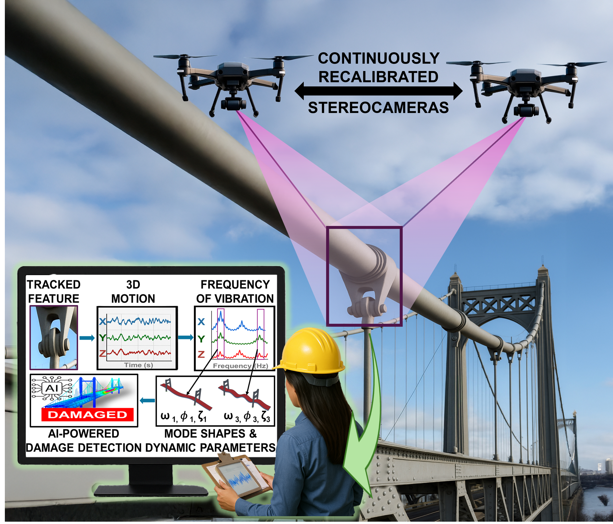

_This blog offers informed opinions and perspectives relating to nascent technologies in data-centric engineering. [Dr. Alessandro Sabato](http://sites.uml.edu/alessandro-sabato/) from the University of Massachusetts Lowell discusses target-free structural health monitoring using remotely paired drones and stereo vision._

---

Bridges vibrate under traffic. Wind turbine blades bend and twist in the wind. Towers sway, subtly but continuously. These motions are not flaws, they are signatures that embed information about structural health and integrity. As infrastructure ages worldwide, the need to measure these dynamic responses accurately, safely, and at scale grows. Yet many of the most precise measurement tools available were designed for laboratories, not for kilometer-long bridges or 80-metre turbine blades.
Recent advances in computer vision and aerial vehicles are beginning to close that gap. Target-free stereo point tracking and hybrid sensor-based calibration for independent drones are redefining how we measure large-scale structures in three dimensions and monitoring those dynamic signatures.

{width=70%}

### The promise and limits of stereo vision in structural monitoring
Three-dimensional digital image correlation (3D-DIC) and three-dimensional point tracking (3D-PT) have long been powerful tools in structural dynamics. By using two synchronised cameras, these techniques triangulate the 3D position of points on a surface and track their motion over time. In laboratory settings, they achieve accuracy comparable to accelerometers and strain gauges without touching the structure -- but they come with constraints. 

3D-DIC and 3D-PT require high-contrast speckle patterns or fabricated optical targets applied to the surface, which ensure reliable stereo matching and tracking. In a laboratory, applying a speckle pattern to a specimen is straightforward; however, on a wind turbine blade or a suspension bridge, it is not. Calibration presents a second barrier. Stereo systems must be rigidly mounted, cannot move, and their intrinsic and extrinsic parameters must be determined using large calibration objects comparable in scale to the field of view. Intrinsic parameters describe the internal geometry of each camera, including focal length, principal point, and lens distortion, which govern how light rays are projected onto the image sensor. Extrinsic parameters, by contrast, define the relative position and orientation between cameras. Once calibrated, the cameras cannot move relative to each other without invalidating these parameters. This requirement effectively confines high-precision stereo vision to laboratory settings. To scale 3D vision to real infrastructure, both assumptions -- fabricated targets and rigid baselines -- must be reconsidered.

### Tracking what is already there
The first step toward that goal is eliminating artificial targets. Large structures are not featureless: they contain bolts, welds, rust patches, letters, holes, edges, and surface irregularities. These inherent features are often distinctive enough to be recognised across images. The challenge is not their existence, it is tracking them robustly in stereo, at sub-pixel resolution, under dynamic conditions. Conventional feature detectors such as SIFT, SURF, or KAZE perform well in static 3D reconstruction tasks; but when extended to stereo tracking of vibrating structures, they tend to mismatch features between views or across frames. The result is discontinuities in displacement signals and spurious harmonics in frequency spectra.

To address these limitations, a new algorithm, namely, the **Augmented Convex Polygon of Gradients (ACPG)**, was developed to isolate and track inherent structural features without artificial markers. Rather than relying on generic feature descriptors, ACPG builds a convex hull around the dominant feature within a user-selected region of interest. A convex hull can be understood as the smallest convex boundary that encloses a set of points, analogous to stretching a rubber band around the outermost pixels associated with a feature. This representation provides a geometrically stable and noise-robust description of the feature’s spatial extent. The centroid of this hull becomes the tracked point. Crucially, the algorithm embeds a custom interpolation kernel that helps preserve sub-pixel fidelity. Why does this matter? Because *structural vibrations are often smaller than a single pixel in the image.* If interpolation introduces artificial edges or gradient discontinuities, tracking precision degrades.

Laboratory validation showed that ACPG can measure 3D displacements of inherent features with accuracy exceeding 99% when compared to traditional optical targets and contact sensors. Here, accuracy reflects agreement in displacement amplitude and frequency under controlled conditions, including stable lighting, mounting, and high signal-to-noise. Even when tracking low-contrast features (i.e., features whose color is the same as the background they are attached to), correlations remained above 99% in controlled tests. In field conditions, performance decreases modestly. In a utility-scale wind turbine blade experiment under variable illumination and long stand-off distances, in-plane displacement measurements maintained correlation above 95%, which remains suitable for modal analysis. Extracted natural frequencies matched accelerometer-based results within 1%, confirming that key dynamic properties are preserved. 

The implication is significant: structures no longer need to be "prepared" with artificial markers to be measured in 3D. **The structure itself becomes the sensing medium.**

### Breaking the rigid baseline and the stationary cameras problem
Removing targets addresses one barrier. Removing rigid stereo frames addresses another. To achieve measurements over large fields of view, stereo cameras benefit from long baselines (i.e., the distance between them), but mounting two cameras metres apart on a rigid bar is impractical for aerial inspection. Most drone-based stereo systems therefore place two cameras on a single UAV, limiting baseline length and size of the inspected structure to a couple of metres across. The alternative explored here is conceptually straightforward yet technically demanding: **deploying two independent UAVs, each equipped with a single camera, to create a dynamically reconfigurable stereo pair.** 

The central challenge lies in calibration. Accurate 3D reconstruction requires precise knowledge of the relative rotation and translation between cameras. When UAVs move independently, these extrinsic parameters change continuously, precluding traditional fixed-frame calibration approaches. The proposed solution leverages sensors already embedded in modern UAV platforms: RTK-GNSS for centimeter-level positioning and gimbal-mounted IMUs for orientation estimation. RTK-GNSS (Real-Time Kinematic Global Navigation Satellite System) enhances standard GPS by using a nearby reference station to correct errors, achieving centimeter-level accuracy. An IMU (Inertial Measurement Unit) estimates the camera’s orientation by combining accelerometers and gyroscopes to track rotations and motion over time. Camera intrinsics are calibrated offline, while extrinsic parameters are computed dynamically from the RTK-GNSS and IMU data. Triangulation thus becomes a real-time, sensor-aided process, eliminating the need for rigid mounts or oversized calibration targets.

In practice, two complications arise. First, commercial UAVs often record GNSS and image data at different sampling rates and with uncertain time alignment. Second, hovering drones inevitably exhibit small translational motions that are not perfectly captured by navigation sensors.

To mitigate these effects, a homography-based motion correction step is introduced. A homography is a transformation that maps points between images of the same plane; for example, how a flat patch of ground appears to shift in the image when the camera moves. By selecting a planar region in the scene (i.e., the patch of ground), feature correspondences between frames are used to estimate a similarity transformation. Each image sequence is warped to align with the initial reference frame using the patch of ground, effectively removing apparent camera motion induced by UAV oscillations before triangulation. With this hybrid visual–inertial framework, large-baseline aerial stereo becomes feasible. Field experiments reduced displacement errors from several centimeters to below 1% relative error, achieving nearly an order-of-magnitude improvement in precision and measurement accuracy on the order of centimeters.

### Toward scalable 3D monitoring of infrastructure
Much work remains: sensor synchronisation must improve, vertical GNSS quantisation must be mitigated, and noise floors must be reduced to enable millimeter-level precision during dynamic flight. Fully integrated multi-sensor payloads with microsecond-level cross-UAV synchronisation may ultimately be required. Yet feasibility has been demonstrated. It is now possible to track inherent structural features in 3D without artificial targets, measure sub-pixel vibrations with strong agreement to contact sensors, form large-baseline stereo pairs from independently hovering UAVs, dynamically estimate extrinsic parameters without rigid mounts, and achieve displacement errors below 1% under field conditions.

For large-scale infrastructure, wind turbines, long-span bridges, rail tracks, this represents more than incremental progress -- it signals a shift toward scalable, non-contact 3D structural monitoring. By measuring structural motion without attaching sensors or preparing surfaces, inspection costs, risk, and operational disruption are reduced while enabling condition-based maintenance rather than fixed inspection intervals.
Ultimately, this approach can reframe how structural behavior is observed: as sensing, synchronisation, and integration improve, aerial stereo systems have the potential to become a practical and transformative tool for continuous, data-driven infrastructure assessment.

---

**Competing Interest:**
[Dr. Alessandro Sabato](http://sites.uml.edu/alessandro-sabato/) is an Associate Professor in the Department of Mechanical and Industrial Engineering at the University of Massachusetts Lowell. His research focusses on integrating non-contact and computer vision techniques with unmanned aerial vehicles to enable automated assessment of large-scale structures. His broader interests include artificial intelligence, drone-borne inspection, image and signal processing, nondestructive evaluation, structural dynamics, and structural health monitoring.

This material is based upon work supported by the National Science Foundation (NSF) under Grant Number 2440348 - CAREER: Enhancing Measurements of Dynamic Features in Large-Scale Structures via Three-Dimensional Aerial Stereovision. Any opinions, findings, and conclusions or recommendations expressed in this material are those of the authors and do not necessarily reflect the views of the National Science Foundation.

**Keywords:**
Structural Health Monitoring; UAV; Drones; Computer Vision; 3D Imaging; Infrastructure; Stereo Vision; Damage Detection

---

_This is the blog for [Data-Centric Engineering](https://www.cambridge.org/core/journals/data-centric-engineering), an open-access journal published by Cambridge University Press and supported by the Lloyd's Register Foundation. You can also find us on [LinkedIn](https://www.linkedin.com/company/data-centric-engineering/). [Here are instructions](https://www.cambridge.org/core/journals/data-centric-engineering/information/instructions-for-authors) for submitting an article to the journal._
