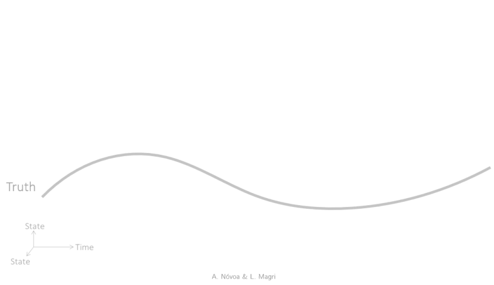

_This blog offers informed opinions and perspectives relating to nascent technologies in data-centric engineering. The DCE journal co-editor-in-chief [Prof. Luca Magri](https://www.lucamagri.com/) (Professor of Scientific Machine Learning at Imperial College London) introduces his research focus and some of the key challenges facing data-driven engineering._

---

{width=100% fig-align="center"}

For the past decade I have worked at the interface between physics and machine learning, with one practical goal, which is to compute the behaviour of engineering systems faster, and more reliably, than we can today. My background is in fluid mechanics, aeronautics and physics, which deal with turbulent, chaotic, multiscale systems in which small errors grow quickly and first-principles models are expensive to solve. These are exactly the systems where data and physics, used together, achieve what neither can alone.

Machine learning has changed what is computationally possible, although in engineering we cannot treat a model as a black box. A prediction that violates conservation of mass or energy is not useful, however good it looks on a benchmark. Much of my group's work therefore concerns physics-aware machine learning, which encodes properties of the governing equations, symmetries, and conservation laws into learning algorithms so that predictions stay physically consistent, interpretable, and trustworthy. The same principles let us forecast chaotic time series, reconstruct high-resolution fields from sparse sensors, and reduce nonlinear models to something we can actually run.

The second thread is real-time computation. Engineering systems generate data continuously, and decisions often have to be made in the loop, whilst an engine runs or a structure is loaded. Real-time data assimilation and digital twins aim to fuse streaming observations with physical models fast enough to keep pace with the system itself. A hard and, to me, fascinating problem here is inferring what we do not know we are missing, which includes model error, bias, and the "unknown unknowns" that no equation in the model accounts for. I am also interested in whether quantum algorithms can help solve the nonlinear equations at the heart of these problems.

{width=80% fig-align="center"}

These interests map onto open questions I hope DCE can help answer. How do we build methods that generalise and extrapolate, with guarantees, rather than interpolate within their training data? How do we quantify uncertainty honestly, which must include uncertainty about the model itself? How do we make physics-based digital twins accurate, robust, and cheap enough to deploy in real time? And how do we, as a field, hold ourselves to standards of reproducibility, which means open code, open data, and shared benchmarks, so that results transfer from a paper to a laboratory to industry?

That last point matters to me. Data-Centric Engineering sits between disciplines that do not always talk to each other, namely mechanics, statistics, computer science, and applied mathematics. Its value lies in insisting that data-driven methods be judged by engineering standards, which are safety, reliability, and physical consistency, rather than predictive accuracy alone. As an open-access journal, it is also well placed to make good work genuinely available.

I served as Executive Editor of DCE for four years, and I am glad to continue as co-editor-in-chief. I look forward to working with authors who want to do careful, honest, and useful science where data and engineering meet.

---

**Competing Interest:**
[Luca Magri](https://www.lucamagri.com) is currently Professor of Scientific Machine Learning, and Director of Research, in the Department of Aeronautics at Imperial College London. He is also Professor in Fluid Mechanics at Politecnico di Torino. He is a co-editor-in-chief of the DCE journal.

**Keywords:**
Physics-aware machine learning; Scientific machine learning; Real-time computation; Digital twins; Data assimilation

---

_This is the blog for [Data-Centric Engineering](https://www.cambridge.org/core/journals/data-centric-engineering), an open-access journal published by Cambridge University Press and supported by the Lloyd's Register Foundation. You can also find us on [LinkedIn](https://www.linkedin.com/company/data-centric-engineering/). [Here are instructions](https://www.cambridge.org/core/journals/data-centric-engineering/information/instructions-for-authors) for submitting an article to the journal._
