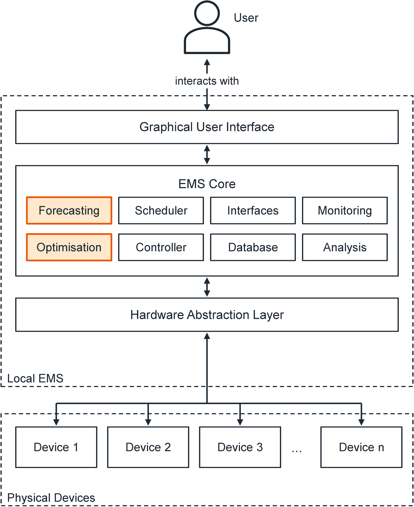
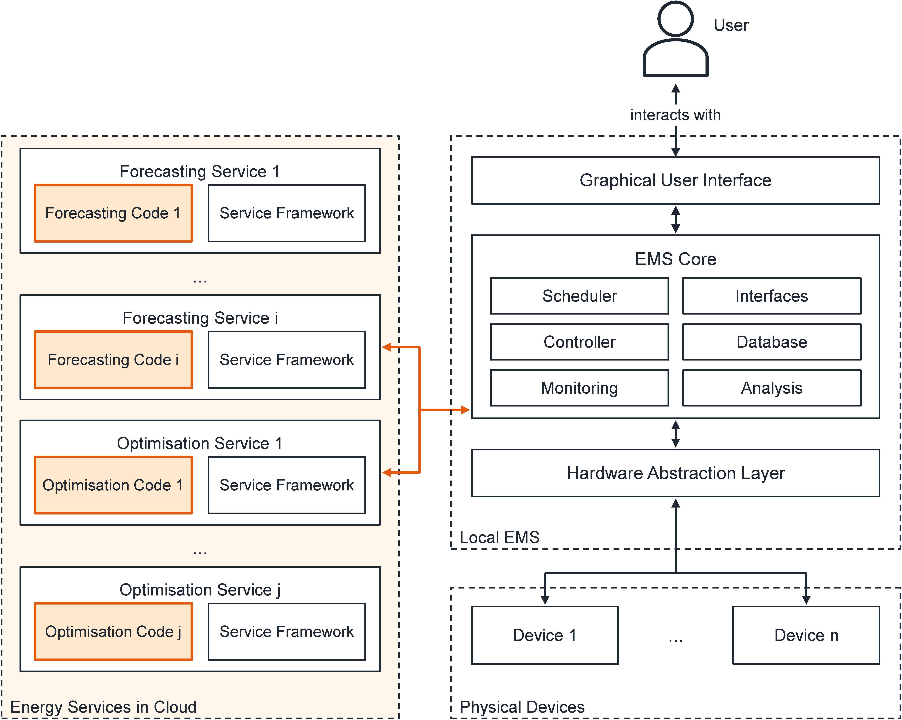

_This blog offers informed opinions and perspectives relating to nascent technologies in data-centric engineering. David Wölfle from the FZI Research Center for Information Technology in Karlsruhe explains how providing forecasting and optimisation as a service could make energy management affordable at scale, and introduces an open-source framework that makes this possible._

---

Software that decides when a building's batteries, heating, and other devices should run can cut energy use, costs, and emissions. But the forecasting and optimisation algorithms it relies on are usually developed separately for each building, and that development can cost more than the building saves.

Global-scale efforts are required to mitigate the most severe consequences of climate change, including a significant increase in the energy efficiency of consumers as well as the decarbonisation of energy supply. The large-scale use of renewable energy needed for decarbonisation will also likely increase consumers' demand for energy flexibility. Energy Management Systems (EMSs), software that computes optimised operating schedules and executes them on devices and systems, have been shown to reduce energy demand, lower CO~2~ emissions, and unlock flexibility. However, to have a practical impact, energy management solutions need to be applied at scale, for example, to thousands of buildings. In [our recent article in Data-Centric Engineering](https://www.cambridge.org/core/journals/data-centric-engineering/article/open-energy-services-forecasting-and-optimization-as-a-service-for-energy-management-applications-at-scale/7A5636FA639225FB9AB3ADF6B521EC3E), we argue that providing forecasting and optimisation as a service can make this economically viable.

### Forecasting and Optimisation as a Service for EMSs

Economic viability is a key factor for the widespread adoption of EMSs. Forecasting and optimisation algorithms are essential parts of EMSs, but have traditionally been developed for a single specific target (e.g., one particular building). This approach is problematic because the development costs of target-specific forecasting and optimisation algorithms are higher than the monetary savings they generate, even for medium-sized commercial buildings. An alternative approach is to replace target-specific forecasting and optimisation algorithms, which are deployed locally as part of each EMS, with generic ones that are provided centrally as web services. Because these services can be used by many EMSs, this reduces the development and operating costs of each individual system. Figure 1 illustrates this idea with a simple example.

{width=100% fig-align="center"}

For readers interested in the technical details, Figures 2 and 3 show how this works inside an EMS. An EMS is essentially a piece of software consisting of three major parts, as summarised in Figure 2: a Graphical User Interface (GUI), which users interact with; a Hardware Abstraction Layer (HAL), which connects the EMS to the physical devices; and an EMS core, which contains the essential management functionality. The core includes the forecasting and optimisation algorithms, a scheduler that invokes these periodically or at certain events, and a controller that ensures that user and hardware constraints are satisfied. Other components include a database for storing measurements and other required data, interfaces for communication, monitoring to detect malfunctions, and analysis tools that calculate metrics relevant to users.

{width=65% fig-align="center"}

Returning to the example in Figure 1, consider a building equipped with a Photovoltaic (PV) System and a Battery Storage System (BSS). To compute an optimised schedule for the BSS, the optimisation algorithm may require predictions of the electric load, PV power generation, and electricity prices. The scheduler first invokes the forecasting algorithms and then forwards the predictions, along with any other required input data, to the optimisation algorithm. In our approach, these algorithms are provided as services that the EMS accesses via standardised interfaces, as summarised in Figure 3. The remaining components continue to operate as part of the local EMS. In particular, the correct operation of the EMS remains the responsibility of the EMS developer, including the implementation of a controller that enforces constraints and provides a sensible default strategy if the optimisation does not work as intended.

{width=90% fig-align="center"}

### The Open Energy Services Framework

To our knowledge, there has so far been no software framework for turning existing forecasting and optimisation algorithms into services, which seems to be a major barrier to their practical use in EMSs.

The Open Energy Services framework has been developed with the intention to minimise the necessary efforts for deriving functional web services from forecasting or optimisation algorithms. To achieve this goal, the development followed a strictly systematic approach, beginning with an extensive analysis of energy management applications in private households, commercial buildings, and districts and areas.

Building upon this analysis, functional and non-functional requirements have been derived that address the development, integration, and operation of forecasting and optimisation services. Based on these requirements, a design concept covering the components, architecture, and operation of services has been developed. Finally, a reference implementation of the design concept, referred to as Energy Service Generics (ESG), has been implemented in Python. The latter is released as a free and open-source repository on [GitHub](https://github.com/fzi-forschungszentrum-informatik/energy-service-generics).

Deriving a fully functional service from existing forecasting or optimisation code requires only a little additional implementation, as the framework provides the functionality generic to all services. The service developer defines data models specifying the format of the input and output data and implements functions that invoke the existing algorithm with the necessary input. The data models and functions are then connected to the components provided by the framework. The ESG source code provides an example of a simple PV power generation forecasting service to illustrate the process, for which deriving the service requires fewer than 100 lines of additional code. Finally, it is worth mentioning that services can be built and deployed as Docker images, which allows scalable operation, for example, on Kubernetes clusters, even for thousands of EMSs.

If you have forecasting or optimisation code that you would like to make available as a service, the [basic example](https://github.com/fzi-forschungszentrum-informatik/energy-service-generics/tree/main/docs/examples/basic_example) in the ESG repository is a good place to start. The [Open Energy Services community](https://open-energy-services.org/), which maintains the framework and aims to develop and provide forecasting and optimisation services, is open for others to join. Full details are available in [our DCE article](https://www.cambridge.org/core/journals/data-centric-engineering/article/open-energy-services-forecasting-and-optimization-as-a-service-for-energy-management-applications-at-scale/7A5636FA639225FB9AB3ADF6B521EC3E).

---

**Competing Interest:**
David Wölfle is a research scientist at the FZI Research Center for Information Technology in Karlsruhe, Germany, where he works on energy management systems. The author declares no competing interests.

**Funding:**
This work was partly funded by the German Federal Ministry for Economic Affairs and Climate Action (projects FlexBlue and AMAZING), the Helmholtz Association (Program Energy System Design), and the European Union (project WeForming).

**Keywords:**
Building energy management; Forecasting; Optimisation; Web services; Open-source software

---

_This is the blog for [Data-Centric Engineering](https://www.cambridge.org/core/journals/data-centric-engineering), an open-access journal published by Cambridge University Press and supported by the Lloyd's Register Foundation. You can also find us on [LinkedIn](https://www.linkedin.com/company/data-centric-engineering/). [Here are instructions](https://www.cambridge.org/core/journals/data-centric-engineering/information/instructions-for-authors) for submitting an article to the journal._
